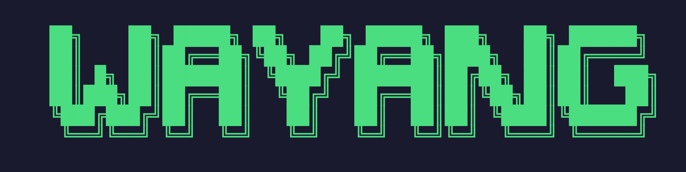

<div align="center">



### Welcome to play with Wayang

Orchestrate multiple AI agents with natural language — plan, dispatch, and coordinate in parallel.

[中文文档](docs/README.zh-CN.md)

</div>

---

## Why Wayang

Complex AI workflows need more than a single chat. Wayang acts as an intelligent **Controller** that understands your intent, decomposes tasks, dispatches them to parallel **Workers**, and synthesizes the results — all through natural conversation.

|                | Capability                                                  |
| -------------- | ----------------------------------------------------------- |
| **Plan**       | Decompose complex requests into parallelizable sub-tasks    |
| **Dispatch**   | Automatically assign Workers, control concurrency           |
| **Coordinate** | Aggregate results, maintain coherent context                |
| **Respond**    | Continue chatting with the Controller while Workers execute |

## Features

- **Intelligent Scheduling** — Controller uses LLM to decompose tasks and dispatch Workers in parallel
- **Non-blocking Interaction** — Keep talking to the Controller while tasks run; never wait idle
- **Task Lifecycle** — Full tracking: create → execute → progress → complete / fail
- **Multi-Worker Parallelism** — Multiple Workers run simultaneously with configurable concurrency limits
- **Rich TUI** — Ink-powered (React for CLI) interface with streaming output, slash commands, and keyboard shortcuts
- **Session Recovery** — `wayang --resume` restores interrupted sessions with automatic crash cleanup
- **Extensible Workers** — Built-in Puppet Worker and Claude Code Worker; plug in custom third-party Workers
- **Headless Server + RPC** — `wayang server` runs the orchestration core as a headless process driven over a JSON-RPC-style stdio protocol; the TUI is a thin client on the same protocol (WebSocket reserved for the upcoming WebUI)
- **Context Compression** — Automatic compact to prevent token overflow

## Architecture

```
┌────────────────────────────────────────────────────────┐
│                    CLI (Ink / React)                   │
├──────────────────────┬─────────────────────────────────┤
│     Controller       │           Worker Pool           │
│    (Orchestrator)    │      (Parallel Execution)       │
│  - Understand intent │  - bash / read / write          │
│  - Plan & decompose  │  - call_agent                   │
│  - Synthesize result │  - done / fail termination      │
├──────────────────────┴─────────────────────────────────┤
│           Supervisor (Orchestration + Lifecycle)       │
├────────────────────────────────────────────────────────┤
│  Signal Queue · Task Pool · Task Scheduler             │
│  Event Bus · State Persistence · Crash Recovery        │
└────────────────────────────────────────────────────────┘
```

**Core principle:** _LLM handles intelligence (understanding, judgment, response); code handles mechanics (scheduling, queuing, state management)._

## Quick Start

### Prerequisites

- Node.js >= 20

### Install

```bash
npm install -g wayang-ai
```

After installation, the global command `wayang` (alias `waya`) is available in your terminal:

```bash
wayang          # start a new session
waya            # shorthand alias
wayang --resume # resume last session
```

On first run, an interactive setup wizard will guide you through configuring your LLM provider.

### Configure

On first run, Wayang launches an interactive setup wizard. Just fill in your LLM provider details.

Or create `~/.wayang.config.json` manually:

```json
{
  "providers": {
    "my-model": {
      "endpoint": "https://api.anthropic.com",
      "modelName": "claude-sonnet-4-20250514",
      "apiKey": "xxx",
      "contextWindowTokens": 200000
    }
  },
  "controller": { "provider": "my-model" },
  "worker": { "provider": "my-model", "maxConcurrency": 3 }
}
```

API key can be set via config or the `WAYANG_LLM_API_KEY` environment variable.

`contextWindowTokens` (optional, per provider) is the model's context window in tokens: the input budget the prompt must fit into, not the protocol's `max_tokens` output cap. The controller compacts the conversation once it reaches 90% of this budget. It defaults to 256000; set it explicitly for smaller-window models (e.g. `128000`), otherwise the provider rejects requests before compaction triggers. With env-only configuration use `WAYANG_CONTEXT_WINDOW_TOKENS`.

Workers default to `"toolChoice": "auto"` — the model decides whether to call a tool, since thinking endpoints (DeepSeek/GLM) reject `tool_choice: "required"` with HTTP 400. On endpoints that support it, set `"required"` to force a tool call every step, so a worker always finishes via its `done`/`fail` tools:

```json
"worker": { "provider": "my-model", "maxConcurrency": 3, "toolChoice": "required" }
```

### Run

```bash
wayang                # new session
waya                  # alias
wayang --resume       # resume last session
wayang --resume 20260403-143052   # resume specific session
wayang --resume --all             # list all sessions to pick
```

### CLI Options

| Flag                  | Description             | Default                 |
| --------------------- | ----------------------- | ----------------------- |
| `--home-dir`          | Data storage directory  | `~/.wayang`             |
| `-w, --workspace-dir` | Agent working directory | cwd                     |
| `-c, --config`        | Config file path        | `~/.wayang.config.json` |
| `--resume [id]`       | Resume a session        | —                       |
| `--verbose`           | Enable verbose logging  | —                       |

## Skills

**Skills** are on-demand expertise packages (Anthropic-style `SKILL.md` + optional resource scripts) that any agent — Controller or Worker — can load at runtime via the `use_skill` tool. Skills are discovered once at startup and shared across all agents through the in-memory registry.

### Discovery

Wayang scans these directories (later ones override earlier ones on name conflict):

1. `~/.wayang/skills/` — global, cross-project skills
2. `<workspace>/.wayang/skills/` — project-level skills (commit these to share with your team)
3. Any extra dirs listed in `config.skillsDirs`

Each skill is a directory containing a `SKILL.md` with YAML frontmatter. Only `description` is required:

```
.wayang/skills/
└── my-skill/
    ├── SKILL.md          # required, with `description` frontmatter
    └── run.sh            # optional resource files (scripts, templates, ...)
```

```markdown
---
description: One-line summary the LLM sees in the skill catalog.
---

# my-skill

Detailed instructions the agent loads on demand via use_skill.
Resource scripts are invoked by the worker's own shell tool — Wayang never
executes them for you.
```

### How agents share skills

- **Controller** sees the skill catalog in its system prompt and can call `use_skill` to load domain knowledge before writing a task description.
- **Puppet Worker** sees the same catalog and has the `use_skill` tool, so it can load skill instructions while executing a task.
- **Claude Code Worker** has no Wayang tools, so its catalog lists each skill's directory — it reads `SKILL.md` with its own file tools.

Skills are read-only config: a worker that has already started won't pick up newly added skills until the next session (or the next worker spawn).

## Project Structure

```
src/
├── cli.ts               CLI entry point (client + `server` subcommand)
├── bootstrap.ts         Client startup orchestration (config/session/spawn)
├── onboard.ts           First-run setup
├── session-select.ts    Session picker
├── rpc/                 RPC v1 protocol, stdio transport, server & client
├── server/              Headless logic process (`wayang server`)
├── client/              Client-side RemoteSupervisor + server connector
├── tui/                 TUI layer (Ink components + hooks + page)
├── services/
│   ├── supervisor.ts     DI container + lifecycle
│   ├── controller-loop.ts Main control loop
│   ├── agents/           Agent layer (Controller + Worker + Prompts + State)
│   ├── skills/           Skill registry (discovery + lazy content loading)
│   ├── task/             Task domain (pool + scheduler + state)
│   ├── signal/           Signal domain (queue + event sourcing state)
│   ├── session/          Session domain (manager + state)
│   └── tools/            Tool implementations (incl. use_skill)
├── infra/                Infrastructure (event-bus, logger, state framework, persistence)
├── types/                Shared types
└── utils/                Utility functions

e2e/                      E2E tests (fake OpenAI provider + server harness + scenarios)
```

## Tech Stack

| Layer             | Choice              |
| ----------------- | ------------------- |
| Language          | TypeScript          |
| LLM SDK           | Vercel AI SDK       |
| CLI Framework     | Ink (React for CLI) |
| CLI Parser        | meow                |
| Pre-start Prompts | prompts             |
| Agent Invocation  | Claude Agent SDK    |
| Persistence       | JSONL + JSON files  |
| Logging           | pino                |
| Build             | tsup                |
| Testing           | vitest              |

## Testing

```bash
npm test           # 39 test files, 332 tests
npm run test:e2e   # build + e2e scenarios (spawns dist server, fake LLM provider)
npm run lint       # type check + lint
```

CI runs lint + unit + build + e2e on every push and pull request.

## Roadmap

**Vision:** evolve from a multi-agent CLI into a **multi-agent collaboration workbench**. The themes below are ordered by priority, not locked to specific versions — scope shifts as real usage feeds back.

1. **Collaboration core** — structured planning (`plan` / `replan`), task groups & dependencies with topology-aware dispatch, human-readable task IDs (`WAY-N`), git worktree isolation so multiple workers can edit one repo in parallel, worker-to-worker channel, cross-session backlog
2. **Execution power** — MCP tool mounting, richer built-in tools (git, code navigation, web fetch), per-worker tool allowlists & skill packs, long-session hardening
3. **Open integration** — ACP client: run Gemini CLI, Claude Code, Codex CLI, and OpenCode as workers over the Agent Client Protocol
4. **Workbench WebUI** — chat, task board, approval center, and worker session replay in the browser, with terminal and browser connected at the same time; lands once the collaboration core gives it a rich data model
5. **Always-on & remote** — daemon mode with scheduled backlog ("perpetual" mode, human-in-the-loop), secure remote access, notifications
6. **Memory & quality loop** — workspace knowledge base, searchable task archive, review worker, tests as the definition of done
7. **Ecosystem** — worker plugin protocol + scaffolding, community skill directory, sandboxing, distribution

**Standing principles:** the Controller stays the single orchestration source — LMs decide, code enforces mechanics; the TUI stays a thin chat client, richer interaction lands on the Web; everything mounts on the headless server + RPC foundation.

Shipped: Controller ↔ Worker chat & permission approval (v0.3), persistent multi-stage workers & sessionless long-running (v0.4), headless server + RPC + e2e & CI (v0.5).

## License

MIT
